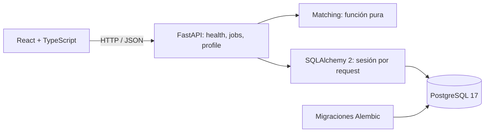

# Arquitectura — Sprint 1

Aplicación local, de un usuario. Monolito modular para mantener simples las transacciones y la operación. No hay workers, agentes, colas, autenticación ni llamadas a LLM.



## Responsabilidades

- `app/api`: contratos HTTP, consultas y transacciones cortas con dependencias reemplazables en tests.
- `app/schemas.py`: validación Pydantic; rechaza campos extra, texto vacío, URLs fuera de HTTP(S), skills inválidas y experiencia fuera de 0–80 años.
- `app/models.py`: persistencia, restricciones y claves foráneas.
- `app/services/matching.py`: función determinista sin red, DB ni estado global.
- `app/core/config.py`: entorno y `.env` raíz. No hay URL de DB por defecto.
- `app/factory.py`: construcción de FastAPI, CORS local y errores SQL genéricos. `main.py` es el punto de entrada ASGI.
- `frontend/src/api.ts`: cliente HTTP con timeout y errores legibles. Los contratos frontend/backend son explícitos; su generación automática se posterga.
- `frontend/src/components`: formularios y tarjeta de oferta; `App.tsx` coordina el dashboard.

No se introduce un repositorio genérico: SQLAlchemy ya proporciona la abstracción necesaria. Las rutas síncronas se ejecutan en el thread pool de FastAPI, con una sesión por request.

## Modelo de datos

| Entidad | Responsabilidad |
| --- | --- |
| CandidateProfile | Perfil técnico sin nombre, email ni CV. Singleton `id=1`, skills, años y preferencias. Se crea explícitamente. |
| JobSource | Procedencia. Alembic crea `id=1`, `Manual`, tipo `manual`. Sin conexión a portales. |
| JobPosting | Puesto, empresa, descripción, ubicación, remoto, requisitos, experiencia, URL opcional, fuente y fecha UTC. |
| MatchScore | Un resultado actual por oferta, con score, componentes, skills coincidentes/faltantes, perfil y versión `deterministic-v1`. |

Skills en JSON, normalizadas con trim, casefold, deduplicación y orden. Las URLs son referencias: el backend nunca las visita. Ofertas inmutables vía API en este sprint. Listado en orden descendente por ID, con paginación `limit/offset`.

El matching actualiza o crea un único resultado: repetirlo con las mismas entradas produce el mismo resultado y no agrega filas. Guardar el perfil elimina los scores previos en la misma transacción. `SELECT FOR UPDATE` sobre el perfil serializa sus actualizaciones y el matching para evitar persistir scores obsoletos. Sin historial de perfiles/scores.

## Matching v1

```text
habilidades = 100 × skills requeridas presentes / cantidad requerida
experiencia = 100 × min(años del perfil / años requeridos, 1)
ubicación   = 100 si no hay preferencia, coincide el texto de ubicación,
              o la oferta es remota y el perfil acepta remoto en cualquier lugar;
              0 en los demás casos
score       = round(0.70 × habilidades + 0.20 × experiencia + 0.10 × ubicación, 2)
```

Skills requeridas vacías o cero años reciben 100 en ese componente, sin penalizar requisitos ausentes. El total se calcula antes de redondear los componentes. Ejemplo: 1 de 2 skills, 2 de 4 años y ubicación aceptada → **55/100**. Es una medida de estas reglas, no una probabilidad de contratación. Sin extracción de texto, sinónimos, seniority ni restricciones geográficas del remoto.

## Infraestructura y pruebas

Compose publica PostgreSQL solo en `127.0.0.1`: desarrollo en 5432 con volumen persistente; pruebas en 5433, con `tmpfs`, base y credenciales diferentes. Puertos configurables. API y Vite también escuchan en loopback según los comandos documentados.

Alembic es el único creador del esquema; el arranque no usa `create_all`. La migración inicial crea tablas, restricciones, índice y fuente manual. `/health/db` ejecuta `SELECT 1`, sin verificar el estado de las migraciones.

Integración exige driver `postgresql+psycopg`, nombre de base terminado en `_test` y destino diferente a desarrollo. Crea un esquema con UUID, ejecuta `upgrade → downgrade → upgrade → check`, aísla tests con transacciones/savepoints y elimina solo su esquema al terminar. Otro test confirma persistencia después de commit desde otra conexión. No se usa SQLite ni se modifica el esquema de desarrollo.

Unitarios usan dependencias reemplazadas y no necesitan PostgreSQL accesible. Vitest usa jsdom, Testing Library y mocks HTTP/API. Se verificó la API con HTTP real y el contenido servido por Vite. La revisión visual no pudo completarse por indisponibilidad de las herramientas de navegador; ver `VALIDATION.md`.

## Seguridad y evolución

Passwords aleatorios en `.env` local ignorado. Sin perfiles personales, CVs, dumps o artefactos generados versionados. `VITE_*` es público. Errores SQL no devuelven consultas, parámetros ni credenciales. La aplicación no configura telemetría.

Sin autenticación: uso exclusivamente local. CORS no reemplaza autenticación. Exponerlo en una red requiere una fase de seguridad adicional.

Futuras fuentes autorizadas podrán transformarse al contrato `JobCreate`; el matching puede evolucionar conservando su contrato. Si se justifica un sistema multiagente, los agentes podrán invocar servicios con permisos y auditoría. No se crean interfaces, procesos o conectores vacíos anticipadamente.
