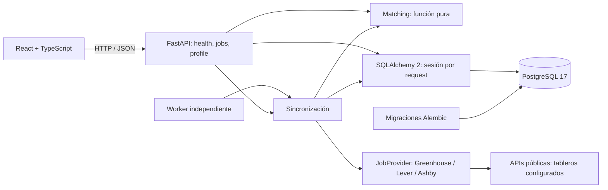

# Arquitectura — Foundation + Discovery Engine + Argentina First

Aplicación local, de un usuario. Monolito modular con un worker opcional de descubrimiento que reutiliza los servicios de la API. Sin agentes, colas, autenticación ni llamadas a LLM.



## Responsabilidades

- `app/api`: contratos HTTP, consultas y transacciones cortas con dependencias reemplazables en tests.
- `app/schemas.py`: validación Pydantic; rechaza campos extra, texto vacío, URLs fuera de HTTP(S), skills inválidas y experiencia fuera de 0–80 años.
- `app/models.py`: persistencia, restricciones y claves foráneas.
- `app/services/matching.py`: función determinista sin red, DB ni estado global.
- `app/services/scores.py`: persistencia compartida de scores entre matching manual y descubrimiento.
- `app/discovery`: contrato `JobProvider`, lectura HTTP, mapeo por proveedor, normalización, preferencias y pipeline persistente.
- `app/worker.py`: ejecución única/periódica independiente del servidor web y de reload.
- `app/core/config.py`: entorno y `.env` raíz. No hay URL de DB por defecto.
- `app/factory.py`: construcción de FastAPI, CORS local y errores SQL genéricos. `main.py` es el punto de entrada ASGI.
- `frontend/src/api.ts`: cliente HTTP con timeout y errores legibles. Los contratos frontend/backend son explícitos; su generación automática se posterga.
- `frontend/src/components`: formularios y tarjeta de oferta; `App.tsx` coordina el dashboard.

No se introduce un repositorio genérico: SQLAlchemy ya proporciona la abstracción necesaria. Las rutas síncronas se ejecutan en el thread pool de FastAPI, con una sesión por request.

## Modelo de datos

| Entidad | Responsabilidad |
| --- | --- |
| CandidateProfile | Singleton `id=1` explícito. Conserva skills, años y preferencias; JSON opcional `professional` versionado con competencias/contexto/confirmación, estudios, trabajos, proyectos, idiomas y objetivos. Sin nombre, email ni CV. |
| JobSource | Fuente manual y tableros públicos: proveedor, empresa, identificador, región, enabled, fechas, error y último resultado. |
| JobPosting | Campos originales más referencia externa, modalidad, URLs, publicación opcional, observaciones, disponibilidad, hash, prioridad, país agrupado, categoría y evidencia JSON. `location_details` conserva ubicaciones completas y países estructurados sin truncar a los 200 caracteres del resumen. |
| MatchScore | Un resultado actual por oferta; componentes 70/20/10 y versión. `deterministic-v1.2-ar` para perfil estructurado, `v1.1` para perfil legado. |
| SearchPreferences | Intereses editables de búsqueda, separados de habilidades/experiencia declaradas por el candidato. |
| SyncRun | Historial de estados, fechas y resultados por fuente de cada ejecución. |

Skills en JSON, normalizadas con trim, casefold, deduplicación y orden. El backend no visita URLs de ofertas: solo consulta los hosts oficiales de API. No hay edición manual de ofertas; el servicio actualiza registros importados. Listado paginado `limit/offset`, ID descendente por defecto, con orden opcional por prioridad o score.

El matching actualiza o crea un único resultado: repetirlo con las mismas entradas produce el mismo resultado y no agrega filas. Guardar el perfil elimina los scores previos en la misma transacción. `SELECT FOR UPDATE` sobre el perfil serializa sus actualizaciones y el matching para evitar persistir scores obsoletos. Sin historial de perfiles/scores.

## Argentina First y perfil estructurado (Sprint 3A)

`services/opportunities.py` implementa reglas puras, sin LLM, y `services/classification.py` las aplica a los modelos. Cada hecho contiene `value`, `status` y `evidence`. `confirmed` significa explícito en el campo de la fuente o la carga manual; `inferred` es una interpretación por reglas; `unknown` conserva la ausencia. No es una verificación legal de admisión o permisos laborales.

La geografía usa ubicación completa y los países estructurados disponibles en Ashby. Argentina explícita se diferencia de CABA/GBA/Buenos Aires inferidos. Córdoba sin contexto extranjero es una inferencia; Córdoba, España no se atribuye a Argentina. Worldwide/LATAM/Americas solo son indicios. Una frase explícita de remoto desde Argentina en la descripción puede habilitar alternativa internacional; menciones de clientes o sedes no lo hacen. Restricciones reconocidas tienen precedencia ante señales contradictorias. La detección no cubre todos los países ni redacciones posibles.

Se reconocen títulos junior/trainee/pasante/entry level y puestos senior/staff/lead/principal. La experiencia numérica, rangos y ciertos números escritos se extraen con fragmento de evidencia; se distinguen requisitos opcionales por línea/sección. Años faltantes son `null` en la evidencia, sin equivaler a cero. `JobPosting.experience_years` conserva el contrato numérico previo para scoring, acompañado por `experience_years_known`. Idioma de la publicación y exigencia de inglés son hechos distintos; prosa inglesa no prueba inglés avanzado. Se exponen posibles requisitos excluyentes y se revisan dominios específicos como experiencia contable.

Categorías: `argentina_priority`, `international_alternative`, `review_needed` y `deprioritized`. La prioridad argentina requiere rol objetivo, señal junior, ubicación nacional compatible y modalidad conocida; presencial/híbrido se limita a la zona preferida. Seniority claramente superior, experiencia mínima mayor al objetivo o restricciones incompatibles despriorizan. Datos ambiguos y roles técnicos cercanos permanecen para revisión. No se elimina ninguna vacante por relevancia.

La revisión de cierre versionó estas reglas como `argentina-v1.1`: inferir junior desde un rango requiere que su extremo superior no exceda el objetivo; 2–4 años queda para revisión. Se reconocen números redundantes concordantes como palabra/dígito entre paréntesis. Las exigencias de comunicación/proficiency en inglés se registran sin inventar un nivel avanzado y requieren revisión si no hay nivel explícito. Los requisitos de fraude se distinguen de conocimientos de SQL. La lista de posibles excluyentes recoge secciones de requisitos y omite encabezados y negaciones como experiencia no requerida. Estas correcciones están cubiertas por regresiones unitarias y de sync repetido/persistencia.

La clasificación considera roles, límite de años, país, preferencia remota, zona e inglés del perfil. Inglés avanzado solo se utiliza cuando el usuario lo confirma. Competencias pendientes participan como declaraciones en el score, sin presumir dominio; el resultado lo advierte. Preferencia de idioma ordena dentro de categoría. El orden `recommended` se aplica en SQL antes de paginar; filtros por país agrupado (AR/otros/desconocido), seniority, clasificación, tablero y publicación se combinan con los existentes.

`ProfileInput.professional` valida listas acotadas, estados y confirmaciones. La evidencia de competencias debe referirse a habilidades declaradas; habilidades nuevas reciben `pending`. Estudios, trabajos y proyectos se conservan separados y nunca incrementan automáticamente años IT remunerados. `schema_version` y `origin` reservan procedencia para importación posterior, sin implementarla. El formulario permite editar estas secciones y guardar contra el mismo singleton.

`GET /profile/draft` carga solo el archivo local indicado por configuración; no recibe paths del navegador ni visita URLs. El archivo es explícito, privado e ignorado por Git. Los errores no devuelven su contenido. `scripts/setup_profile.py` valida y persiste ese borrador; preserva un perfil existente salvo `--replace`, y permite reclasificar históricos. Actualizar el perfil reclasifica todas las filas e invalida scores bajo el bloqueo existente. Ninguna migración contiene información profesional del usuario.

Para perfiles estructurados, `v1.2-ar` conserva pesos y skills exactas, pero exige evidencia argentina para otorgar puntos geográficos. Remoto desconocido no los recibe y presencial requiere zona compatible. La función recibe la evidencia completa persistida aunque el resumen de ubicación tenga 200 caracteres. La convención anterior de score para requisitos ausentes permanece; por eso score y clasificación se muestran separados y no son probabilidad de contratación.

## Matching v1

```text
habilidades = 100 × skills requeridas presentes / cantidad requerida
experiencia = 100 × min(años del perfil / años requeridos, 1)
ubicación   = 100 si no hay preferencia, coincide el texto de ubicación,
              o la oferta es remota y el perfil acepta remoto en cualquier lugar;
              0 en los demás casos
score       = round(0.70 × habilidades + 0.20 × experiencia + 0.10 × ubicación, 2)
```

Skills requeridas vacías o cero años reciben 100 en ese componente, sin penalizar requisitos ausentes. El total se calcula antes de redondear los componentes. Ejemplo: 1 de 2 skills, 2 de 4 años y ubicación aceptada → **55/100**. Es una medida de estas reglas, no una probabilidad de contratación. Se conservan las ponderaciones originales; `v1.1` corrige la comparación de alternativas explícitas de ubicación separadas por `/`, `;`, `|` o salto de línea, ignorando etiquetas conocidas de modalidad. No infiere países ni equivalencias geográficas.

Para ofertas importadas, una capa previa identifica menciones exactas de tecnologías conocidas y expresiones explícitas de años de experiencia. No interpreta requisitos opcionales versus obligatorios; la interfaz lo advierte con `requirements_inferred`. Si no puede determinar años, conserva 0 para compatibilidad con Sprint 1 y expone `experience_years_known=false`; no lo presenta como un requisito declarado de cero años. Nunca modifica el perfil del candidato ni crea uno por defecto.

La prioridad de búsqueda, independiente del score de compatibilidad, combina rol (45), tecnologías de interés (25), ubicación textual (15) y experiencia junior/ambigua (15). Un título claramente senior recibe un factor 0.35 cuando está activada esa preferencia. No se descartan títulos ambiguos. Worldwide/Americas/LATAM solo aportan una pista regional cuando se busca Argentina; no confirman permisos ni elegibilidad.

## Pipeline de descubrimiento

`Fetch → Validate → Normalize → Deduplicate → Persist → Filter/Prioritize → Match`.

Las tres variantes de `PublicBoardProvider` implementan `JobProvider.fetch(BoardConfig)`. `JsonReader` centraliza GET, JSON, timeout, reintentos y pausas; `MockTransport` permite tests sin red. Los hosts están fijados en código y el identificador del tablero tiene un patrón acotado. Lever pagina de 100 en 100; el máximo de 20 páginas evita ciclos no acotados. Ninguna fuente es una API de búsqueda global.

Cada respuesta debe validarse completamente antes de persistir o marcar ausencias. Una página fallida, JSON inválido, campos críticos ausentes o paginación incompleta producen error para esa fuente. Los demás proveedores siguen ejecutándose. No se recuperan publicaciones internas ni se usan endpoints de postulación.

La clave única `(source_id, external_id)` incluye el namespace de proveedor/tablero. Un hash de los datos normalizados distingue nueva/actualizada/sin cambios. Fecha de descubrimiento e ID permanecen; última observación avanza. Solo una lectura completa permite marcar las referencias no vistas como `potentially_inactive`. No se borran ni se afirman cerradas, y una reaparición las reactiva.

Entre fuentes solo se marca un alias si coinciden URL de postulación normalizada, empresa y título; no hay fusión difusa. Se conservan query params identificadores (por ejemplo `gh_jid`), eliminando únicamente trackers conocidos y fragmento. Los alias preservan historial y se ocultan por defecto; `include_duplicates=true` los revela. Una referencia observada puede promoverse si su original ya no está activo.

Todas las vacantes válidas se persisten. Los títulos explícitos de Talent Pool/bolsa de talento se excluyen antes de normalizar en los tres proveedores, además del filtro de prospect posts de Greenhouse. Sus históricos previos no se borran: quedan fuera del conjunto de vacantes activas. Filter/Prioritize significa anotar prioridad y filtrar consultas, no eliminar resultados que no encajen con las preferencias. Matching mantiene la función determinista y se ejecuta únicamente cuando existe perfil declarado. Un cambio de preferencias recalcula prioridades sin tocar la experiencia del candidato. Las expresiones de años incluyen experiencia profesional/ingeniería y líneas explícitas de requisitos como `3+ years in...`; continúa siendo una inferencia limitada, no interpretación semántica completa.

## Concurrencia y operación

`synchronize` utiliza un advisory lock de sesión PostgreSQL en una conexión dedicada, conservada durante toda la ejecución. API y worker comparten la misma clave y DB; una segunda sincronización obtiene 409 o se omite en el worker. El lock se libera en `finally` y PostgreSQL lo elimina al cerrar la conexión tras un proceso caído. Cada fuente confirma su propia transacción. El perfil se bloquea con el mismo orden que en el matching manual, preservando la invalidación de scores.

`SyncRun` se confirma como running antes del fetch y registra resultados al terminar. Las fuentes guardan intento, éxito, error y contadores. El próximo run marca como interrupted las ejecuciones running que quedaron sin lock. No hay lease distribuido ni cola; para este sistema local basta con PostgreSQL. `/sync/status` verifica el lock real, además de consultar el último run.

El worker ejecuta un ciclo inmediato y espera el intervalo desde su finalización. Puede ejecutarse como proceso supervisado o invocarse con `--once` desde un scheduler. No se inicia desde el lifespan de FastAPI y no depende de `--reload`. Los logs de descubrimiento son eventos JSON; la UI consulta estado cada 10 segundos y permite pausar fuentes.

Sprint 3A agrega `JobSource.next_allowed_at` y `consecutive_failures`: espera mínima tras éxito y backoff exponencial tras error, persistidos entre procesos y compartidos por API/worker bajo el advisory lock. `Retry-After` numérico largo o fecha se transmite desde el lector al cooldown. Una fuente en espera devuelve `deferred` sin fetch ni cambios de disponibilidad. 401/403/404 y regiones inválidas pausan la fuente. Los tiempos operativos y contadores aparecen en `/sources` y el dashboard.

`config/sources.json` es configuración pública. El registro de tableros ocurre de forma idempotente al consultar fuentes o sincronizar, con upsert por proveedor/tablero/región. Actualiza etiquetas de empresa sin reactivar pausas persistidas; entradas deshabilitadas o retiradas fuerzan pausa y conservan su historial. Sin escrituras de configuración ni creación de tareas del SO desde la API.

## Infraestructura y pruebas

Compose publica PostgreSQL solo en `127.0.0.1`: desarrollo en 5432 con volumen persistente; pruebas en 5433, con `tmpfs`, base y credenciales diferentes. Puertos configurables. API y Vite también escuchan en loopback según los comandos documentados.

Alembic es el único creador del esquema; el arranque no usa `create_all`. La migración inicial crea las cuatro entidades base; `2e57c63bd9b7` agrega descubrimiento sin eliminar datos, conserva fechas históricas y traslada el remoto manual a modalidad. Un test dedicado crea datos del esquema Sprint 1 y comprueba su preservación. `/health/db` ejecuta `SELECT 1`, sin verificar el estado de las migraciones.

`0003_argentina_first` agrega perfil opcional, ubicación completa, evidencia, clasificación, índice y cooldown sin borrar filas ni scores. Los históricos parten de clasificación desconocida/revisión; `setup_profile.py --reclassify-only`, guardar perfil o sincronizar los actualiza. Se comprueba preservación explícita de perfiles, ofertas y scores del Sprint 2, además del test de Sprint 1. El primer sync actualiza hashes por los nuevos campos normalizados sin cambiar referencias externas ni primera observación.

Integración exige driver `postgresql+psycopg`, nombre de base terminado en `_test` y destino diferente a desarrollo. Crea un esquema con UUID, ejecuta `upgrade → downgrade → upgrade → check`, aísla tests con transacciones/savepoints y elimina solo su esquema al terminar. Otro test confirma persistencia después de commit desde otra conexión. No se usa SQLite ni se modifica el esquema de desarrollo.

Unitarios usan dependencias reemplazadas y no necesitan PostgreSQL accesible. Vitest usa jsdom, Testing Library y mocks HTTP/API. Se verificó la API con HTTP real y el contenido servido por Vite. La revisión visual no pudo completarse por indisponibilidad de las herramientas de navegador; ver `VALIDATION.md`.

## Seguridad y evolución

Passwords aleatorios en `.env` local ignorado. Sin perfiles personales, CVs, dumps o artefactos generados versionados. `VITE_*` es público. Errores SQL no devuelven consultas, parámetros ni credenciales. La aplicación no configura telemetría.

Sin autenticación: uso exclusivamente local. CORS no reemplaza autenticación. Exponerlo en una red requiere una fase de seguridad adicional.

Futuras fuentes autorizadas podrán implementar `JobProvider` y producir `NormalizedJob`. Si se justifica un sistema multiagente, los agentes podrán invocar estos servicios con permisos y auditoría. No se implementan postulaciones, envíos, agentes ni Sprint 3B. Evidencia actual y límites: [SPRINT_3A_VALIDATION.md](SPRINT_3A_VALIDATION.md); los informes previos conservan los resultados de sus respectivas versiones.
